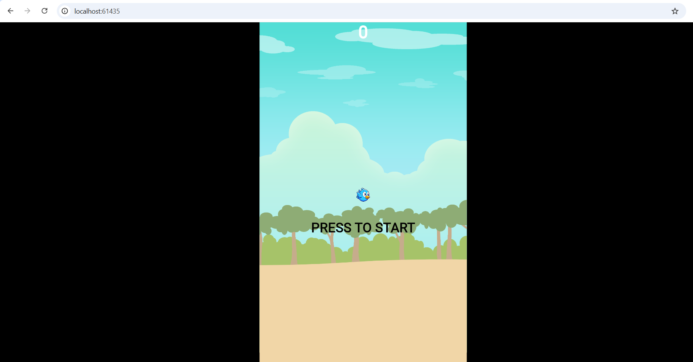
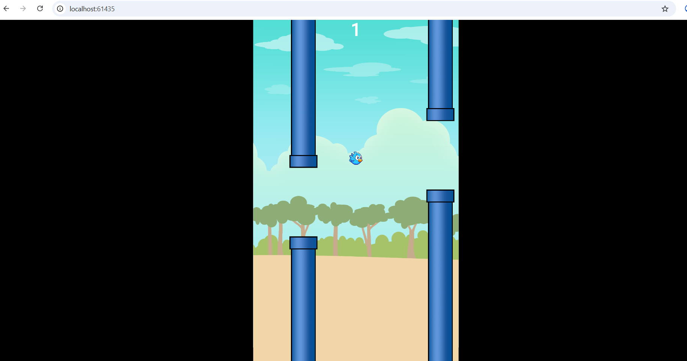
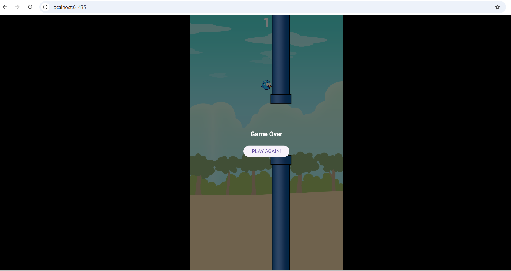

# 🐦 Flappy Dash – Flutter & Flame Game

A 2D game development project built using **Flutter**, **Dart**, and the **Flame Game Engine**.

Demonstrating how to build the Flappy Dash game using Flutter and Flame.

## 📱 Screenshots

<p align="center">
  Flappy Dash
</p>

<table align="center">
  <tr>
    <td align="center">
      <strong>Start Game</strong><br><br>
      
    </td>
    <td align="center">
      <strong>Playing Game</strong><br><br>
      
    </td>
    <td align="center">
      <strong>Game Over</strong><br><br>
      
    </td>
  </tr>
 
</table>


## 📌 Project Information

| Detail | Information |
|---|---|
| Project Name | Flappy Dash |
| Framework | Flutter |
| Language | Dart |
| Game Engine | Flame |
| State Management | Flutter Bloc |
| Flame Integration | Flame Bloc |
| Equatable | Object equality |
| Dart SDK | ^3.13.2 |
| Repository | [AkashMatlani/flappy_dash](https://github.com/AkashMatlani/flappy_dash) |

---

## 🛠️ Technologies & Packages

This project uses the following technologies and packages:

| Package | Version | Description |
|---|---|---|
| [Flutter](https://flutter.dev/) | SDK | Cross-platform application framework |
| [Flame](https://pub.dev/packages/flame) | ^1.38.2 | 2D game engine |
| [Flame Bloc](https://pub.dev/packages/flame_bloc) | ^1.12.24 | Bloc integration for Flame |
| [Flutter Bloc](https://pub.dev/packages/flutter_bloc) | ^9.1.1 | State management |
| [Equatable](https://pub.dev/packages/equatable) | ^3.0.0 | Simplifies object equality |
| [Cupertino Icons](https://pub.dev/packages/cupertino_icons) | ^1.0.8 | iOS-style icons |

### Development Dependencies

| Package | Version | Description |
|---|---|---|
| Flutter Test | SDK | Testing framework |
| [Flutter Lints](https://pub.dev/packages/flutter_lints) | ^6.0.0 | Recommended Dart and Flutter lint rules |
| [Build Runner](https://pub.dev/packages/build_runner) | ^2.17.1 | Code generation utility |

---

## 🚀 Getting Started

Follow these instructions to clone and run the project locally.

### Prerequisites

Make sure you have installed:

- [Flutter SDK](https://docs.flutter.dev/get-started/install)
- Dart SDK ^3.13.2 (included with Flutter)
- [Android Studio](https://developer.android.com/studio) or [Visual Studio Code](https://code.visualstudio.com/)
- Android Emulator, iOS Simulator, or a supported physical device.

### 1. Clone the Repository

```bash
git clone https://github.com/AkashMatlani/flappy_dash.git
```

### 2. Navigate to the Project Directory

```bash
cd flappy_dash
```

### 3. Install Dependencies

```bash
flutter pub get
```

### 4. Run the Application

```bash
flutter run
```

---

## 📂 Project Assets

The project includes the following asset directories:

```text
assets/
├── images/
│   └── background/
└── screenshots/
  
```

These directories are configured in `pubspec.yaml` for loading game images and background assets.

---

## 📦 Useful Commands

Here are some useful Flutter commands for working with this project.

**Get dependencies:**

```bash
flutter pub get
```

**Run the application:**

```bash
flutter run
```

**Analyze the project:**

```bash
flutter analyze
```

**Run tests:**

```bash
flutter test
```

**Build APK:**

```bash
flutter build apk
```

**Build release APK:**

```bash
flutter build apk --release
```

**Check outdated dependencies:**

```bash
flutter pub outdated
```

---


## 👨‍💻 Author

**Akash Matlani**

- GitHub: [@AkashMatlani](https://github.com/AkashMatlani)
- Repository: [Flappy Dash](https://github.com/AkashMatlani/flappy_dash)

---

## ⭐ Support

If you find this project helpful:

- Give this repository a ⭐ Star.
- Explore the source code and learn Flutter game development.

---

**Made with ❤️ using Flutter, Dart & Flame.**